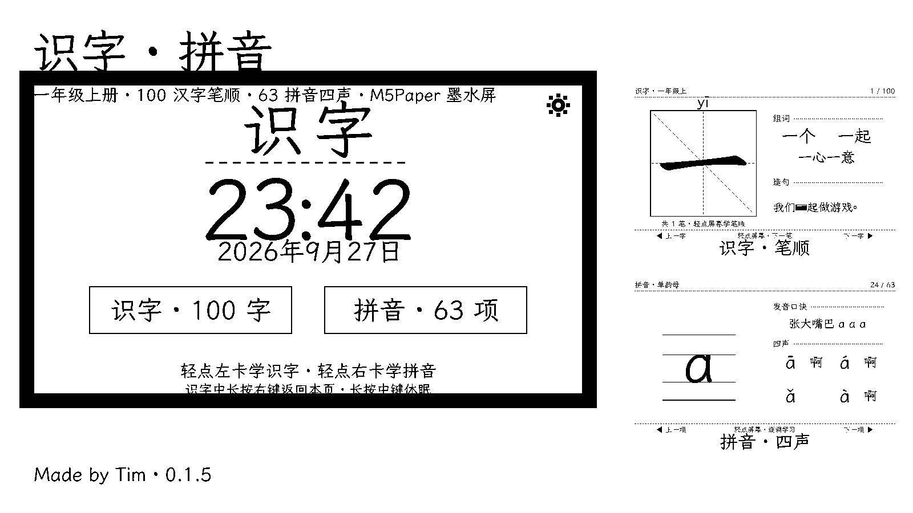
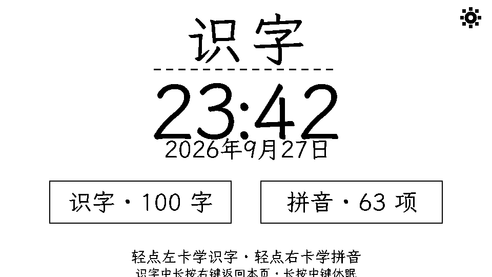
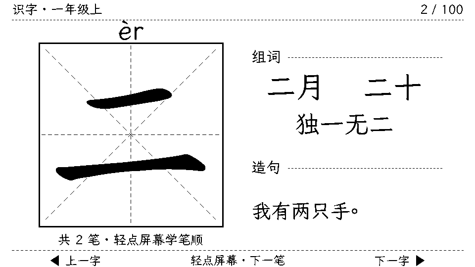
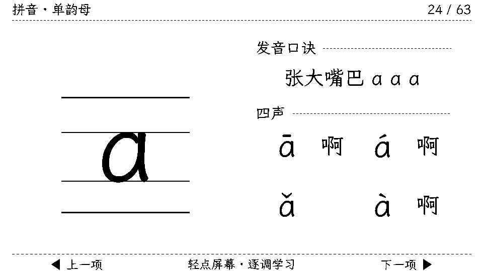

# 识字 · 拼音 — M5Paper 儿童墨水屏学习卡

> **Made by Tim** · v0.1.5
> 电子墨水屏护眼学习伴侣：无背光、深睡省电、进度记忆



## 功能

| 模块 | 内容 |
|---|---|
| **识字** | 一年级上册 **100 汉字**（部编版写字表全册）· 认 → 写 → 用 认知闭环 |
| | 认：完整字 + 拼音 + 组词（2 二字词 + 1 四字词）+ 造句（目标字反白） |
| | 写：**米字格逐笔演示**（当前笔实心 / 已写衬灰 / 未写轮廓）+ 笔画名 + 笔顺序列 |
| **拼音** | **63 项**：声母 23 · 韵母 24 · 整体认读 16 |
| | 四线三格（字母基线锚定）· 发音口诀 · 例字 · 韵母/整体认读**四声逐调演示** |
| **首页** | 大时钟 + 日期 + 双入口卡片 |
| **对时** | 轻点时钟区 → Wi-Fi 连接 + SNTP 网络对时（未配置时直达配网） |
| **设置** | 右上角齿轮 → Wi-Fi 扫描配网（触摸密码键盘）/ 立即对时 / 关于 |
| **省电** | 空闲 5 分钟自动深睡（墨水屏保画，侧键唤醒续学） |





## 安装

### 方式一：M5Burner（推荐）

1. 打开 M5Burner → 设备选择 **M5Paper**
2. 进入用户固件 / Publish Firmware，指向本仓库（含 `m5burner.json`）
3. 一键烧录（含全部数据分区，约 11MB）

### 方式二：esptool 手动烧录

```bash
# 替换 PORT 为你的串口 (macOS: /dev/cu.usbserial-*, Windows: COMx)
PORT=/dev/cu.usbserial-XXXXX
esptool.py --chip esp32 -p $PORT -b 460800 write_flash \
  0x1000    firmware/bootloader_0x1000.bin \
  0x8000    firmware/partitions_0x8000.bin \
  0x10000   firmware/shizi_card_0x10000.bin \
  0x310000  firmware/shizi_0x310000.bin \
  0xb80000  firmware/pinyin_0xb80000.bin
```

> 文件名即烧录地址（`名字_地址.bin`），五个文件缺一不可。

## 使用

| 操作 | 动作 |
|---|---|
| 首页轻点左卡 / 右卡 | 进入识字 / 拼音 |
| 首页轻点时钟区 | 网络对时 |
| 首页右上角齿轮 | 设置（配网 / 对时 / 关于） |
| 识字中轻点屏幕 | 逐笔演示（左 1/3 = 上一笔回看） |
| 左 / 右侧键短按 | 上一项 / 下一项 |
| 中键短按 | 重播 |
| 长按左键 1.5s | 转屏方向（记忆） |
| 长按中键 2s | 深睡 |
| 识字中长按右键 1.5s | 返回首页 |

## 硬件 / 技术

- **M5Paper**（ESP32-D0WD · 960×540 电子墨水屏 IT8951 · GT911 触摸 · 16MB Flash）
- ESP-IDF v5.5.1 + M5GFX
- 内容管线：makemeahanzi 笔画数据 + 规范笔顺表 + 楷体字形 → 全量预烘焙位图
- 首发认知设计：认字音形 → 写笔顺动觉 → 用组词造句

## 版本

| 版本 | 说明 |
|---|---|
| 0.1.5 | 首个公开发布：识字 100 字 + 拼音 63 项 + Wi-Fi 对时 + 设置 |

---

**识字 · 拼音** · Made by Tim · 0.1.5
