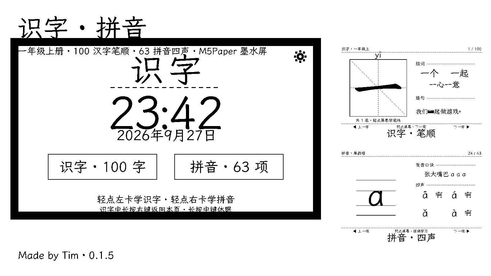
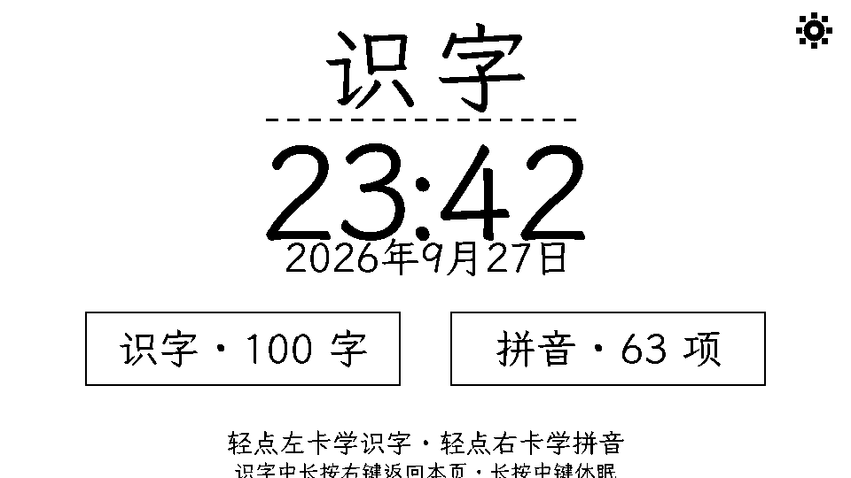
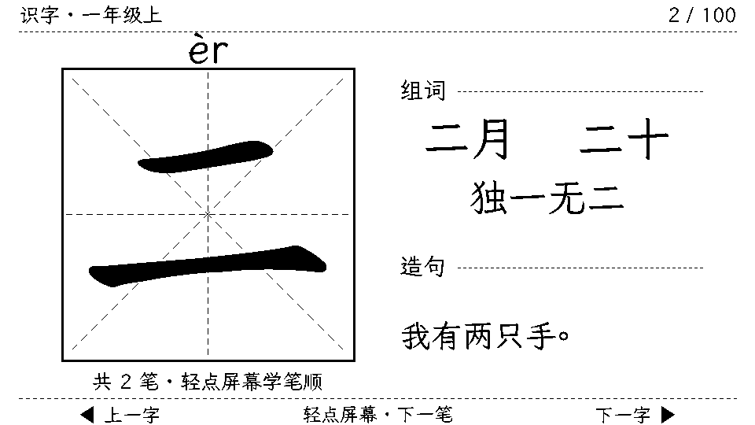
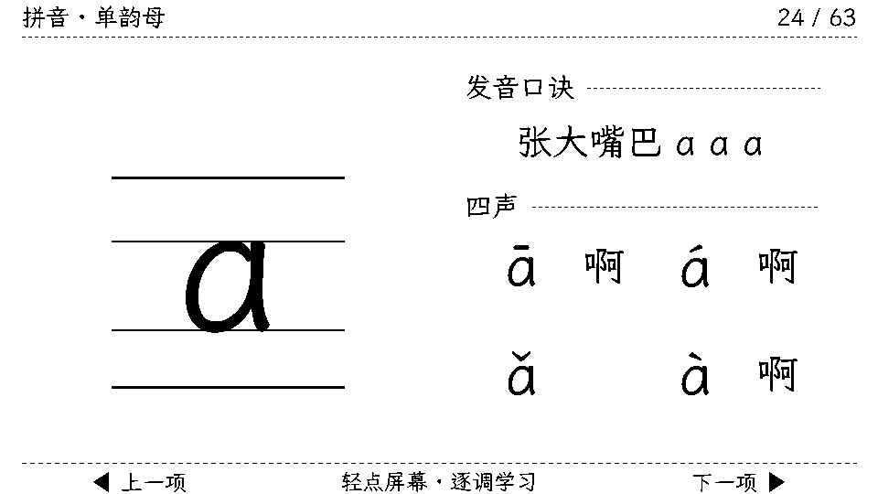

# [M5Paper] 识字·拼音 — E-Ink Learning Cards for First Graders (100 Chinese Characters + Pinyin)

> **A paper-like, eye-friendly literacy companion for kids.** 100 Chinese characters with stroke-order animation + 63 pinyin items with four-tone demos — all on the M5Paper's glare-free e-ink display. No backlight, weeks of battery, remembers where your child left off.



## Why e-ink for kids?

Children learning to read stare at screens for hours. E-ink is passive, reflective light — like paper — so it's dramatically easier on young eyes. M5Paper's 960×540 7.5" display is large enough for big characters, and the built-in battery support plus deep sleep means it's always ready without charging anxiety.

## What it does

The app follows how children actually learn characters — a **Recognize → Write → Use** loop:

| Module | Content |
|---|---|
| **识字 (Characters)** | All **100 characters** from the Grade-1 first-semester standard writing list |
| | **Recognize**: full character + pinyin + words + example sentence |
| | **Write**: **stroke-by-step animation** in a 米字格 rice grid — current stroke solid, completed strokes grayed, remaining strokes outlined, with stroke names (横/竖/撇/捺…) |
| | **Use**: words & sentence with the target character highlighted |
| **拼音 (Pinyin)** | **63 items**: 23 initials, 24 finals, 16 whole-syllables |
| | Four-line three-grid (properly baseline-aligned!), pronunciation mnemonics, example words, and **four-tone step-through** (ā á ǎ à) for every final |
| **Clock & Sync** | Big clock on home; tap it for **Wi-Fi NTP time sync** |
| **Settings** | Wi-Fi provisioning with on-screen touch keyboard, sync, about |

## Screenshots



*Home — clock, date, two entry cards. Top-right gear for settings.*



*Character card — rice grid, pinyin, words, sentence.*



*Pinyin card — four-line grid with tone overview.*

## Interaction (kid-simple)

- **Tap screen** → next stroke / next tone
- **Side buttons** → previous / next item, replay
- **Long-press** → rotate screen / back to home / deep sleep
- Idle 5 min → auto deep sleep (e-ink keeps the picture, RTC keeps the time) — wake with any button and continue exactly where you left off

## Install

**Option 1 — M5Burner**: point to the repo below (contains `m5burner.json`).

**Option 2 — esptool**:
```bash
esptool.py --chip esp32 -p PORT -b 460800 write_flash \
  0x1000    firmware/bootloader_0x1000.bin \
  0x8000    firmware/partitions_0x8000.bin \
  0x10000   firmware/shizi_card_0x10000.bin \
  0x310000  firmware/shizi_0x310000.bin \
  0xb80000  firmware/pinyin_0xb80000.bin
```

**Repo (firmware + docs): https://github.com/hongxin/m5paper-shizi**

## Tech notes

- ESP-IDF v5.5.1 + M5GFX, ~950KB app + 10MB pre-baked 1-bpp content partitions
- Content pipeline: makemeahanzi stroke data + hand-verified stroke-order names + Kai-style font, all rasterized offline into RLE-packed frame sequences
- Full stroke-order names table validated character-by-character (94/94 match official standard)
- Wi-Fi used only during time sync, then powered off

---

**识字·拼音 v0.1.5** — Made by Tim. Free for every kid learning to read. 
Feedback and feature requests welcome — next up: Grade-1 semester 2 (200 more characters) and tracing practice.
